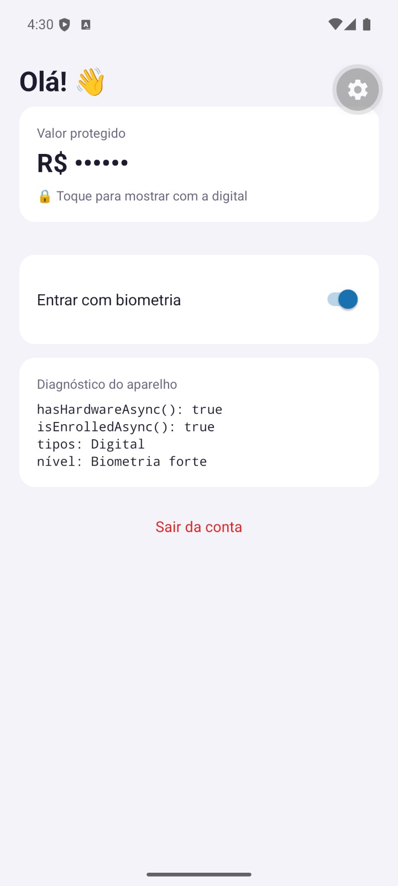
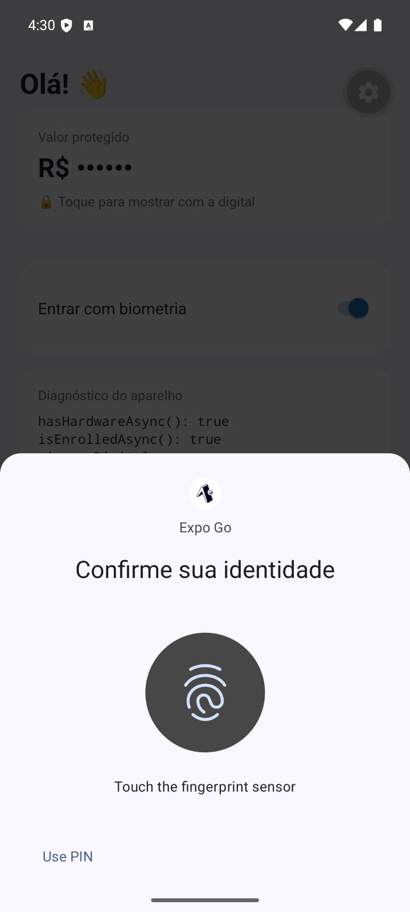
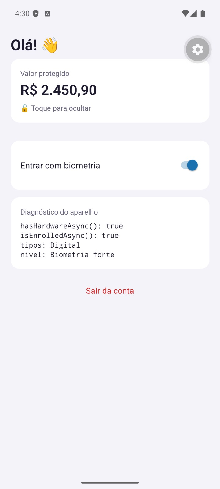

# Demo Biometria: verificação biométrica no React Native

App de demonstração (Expo SDK 58 / React Native 0.88) que mostra a verificação de identidade pela digital:

1. **Login com e-mail e senha** → pergunta se quer ativar a biometria
2. **Ao reabrir o app** (ou voltar do segundo plano depois de 5 s) → tela de bloqueio com a digital
3. **Valor protegido** → fica oculto e só aparece depois da biometria
4. **Fallback** para a senha do aparelho e para o login com e-mail e senha

Bibliotecas: `expo-local-authentication` (prompt biométrico) e `expo-secure-store` (token criptografado no Android Keystore). A demo é só para Android.

## Como rodar

```bash
npm install
npx expo start
```

| Onde                                  | Funciona?                                                                    |
| ------------------------------------- | ---------------------------------------------------------------------------- |
| **Android físico + Expo Go**          | ✅ Mais fácil. Digital funciona direto no Expo Go                             |
| Emulador Android                      | ✅ Cadastre uma digital em Configurações > Segurança; simule com `adb -e emu finger touch 1` ou pelo painel *Extended controls > Fingerprint* do emulador |

> Para gravar a demo: **Android físico com Expo Go**, usando o gravador de tela do próprio celular. Se a janela da digital aparecer preta na gravação (alguns aparelhos escondem por segurança), filmem a tela com outro celular.

Dados de login fake: qualquer e-mail válido (ex.: teste@exemplo.com) e senha com 4+ caracteres.

## Estrutura

```
App.tsx              máquina de estados: carregando → login | bloqueado | home + AppState
src/biometria.ts     checarSuporte(), autenticar(), traduzirErro()  ← o coração da feature
src/sessao.ts        token e preferência no SecureStore + login fake
src/telas/Login.tsx  login + oferta de ativar a biometria
src/telas/Bloqueio.tsx  tela de bloqueio que abre o prompt sozinha
src/telas/Home.tsx   valor protegido, switch da biometria e painel de diagnóstico
```

## Prints

| 1. Valor oculto | 2. Verificação biométrica | 3. Valor à mostra |
| :---: | :---: | :---: |
|  |  |  |

Para reproduzir: entre com `teste@exemplo.com` / `1234`, ative a biometria e toque no card “Valor protegido”.
